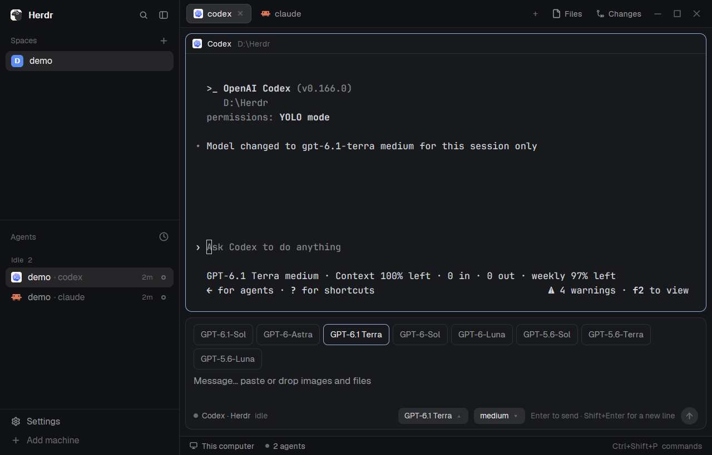
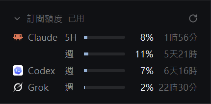

# Chat box for Herdr

A desktop-style message box under your terminals. Type with a real text editor, paste or drop images and files, and switch the agent's model and reasoning effort without leaving the box.



[繁體中文說明](#繁體中文)

## What it does

- **Enter** sends, **Shift+Enter** starts a new line, **Esc** returns to the terminal, **Ctrl+Shift+J** jumps to the box.
- **Images and files:** paste or drop them in. They go to the agent as file paths, which Claude Code attaches as images.
- **Model and effort menus** for Claude Code, Codex and Grok.
- **A draft per terminal,** so switching tabs never carries text across.

| Agent | What a switch changes |
|---|---|
| Claude Code | This session only |
| Codex | This session only |
| Grok | **Also Grok's default for later sessions.** Grok has no session-only option, and the box says so when you switch |

## Requirements and limits

- **Windows only.** Pasting and previews use PowerShell, and paths use backslashes.
- Tested on Windows 11 with Herdr 0.1.12.
- There's no API for switching models, so the menus read each agent's screen and drive its own commands. An agent update that changes those screens can stop a switch. The box then leaves the agent's menu with Esc and shows an error, without changing anything.
- Claude Code and Grok's model lists are written in `mods/chat-box/agents.js`. Codex's comes from its own cache.

## Install

Ask your agent inside Herdr to add this repo, or do it by hand:

1. Copy `mods/chat-box` to `~/.config/herdr-app/mods/`.
2. Copy `layouts/main-chat.json` to `~/.config/herdr-app/layouts/`.
3. Add `"ctrl-shift-j": "chat-box.focus"` to `global` in your `keys.json`, if that key is free.
4. Run `herdr-app check` on the mod folder, then `herdr-app do layout.switch --name main-chat`.

`Ctrl+Shift+L` switches back to your old layout. Delete the copied files to remove it.

`main-chat` is a copy of Herdr's `main` layout from 0.1.12, with the box added. If you've changed your layout, you can add just the block instead:

```json
{ "id": "chat", "type": "block", "size": { "px": 96 }, "content": { "mod": "chat-box", "props": { "fit_block": "chat" } } }
```

For a Traditional Chinese interface, add `"lang": "zh-TW"` to those `props`.

### What this mod can touch

- **Runs programs:** `hc` to talk to your terminals, and `powershell.exe` to read the clipboard and copy images for previews.
- **Reads outside its folder:** `~/.codex/models_cache.json`, plus any file you paste or drop.
- **Types into your agent:** a switch sends `/model` or `/effort` to the focused agent. It refuses while the agent is working or waiting for you.
- **Writes:** pasted images and previews go to `data/chat-box/` in your Herdr home and are removed after 7 days. Grok's switch changes `~/.grok/config.toml`, through Grok's own commands.
- **No network** of its own.

## Optional: hide the agents' own input boxes

With the box installed, each agent still draws its input box in the terminal above. Official Herdr has no way to hide it, so this part needs a patched build. Skip it if you don't mind two input boxes.

With the patch, and only in layouts that set `"message_box": "chat-box"` (`main-chat` does):

- The terminal shows only the agent's output. Claude Code, Codex and Grok are recognized; any other program is left alone.
- Permission dialogs and pickers stay fully visible, because only an exact match of an input box hides anything.
- Text you type in that terminal moves to the chat box.

**You need:** Rust 1.95.0, Zig 0.16.0, libclang and [`just`](https://github.com/casey/just). The patch was tested on Windows; the mod itself is Windows-only.

```sh
git clone -c core.autocrlf=false https://github.com/herdrdev/herdr-app.git
cd herdr-app
git checkout 816d2057d83f0cbd3705926c0231fb12963ae0fb
git submodule update --init
git apply ../tackbear-herdr-mod/patches/hide-agent-input.patch
cargo +1.95.0 test --release --locked --bin herdr-app agent_input
just install
```

- **`just install` replaces your installed Herdr** (`%LOCALAPPDATA%\Programs\herdr-app` on Windows). Back it up first. Quit and reopen Herdr to use the new build.
- The patch targets the commit above. On a newer Herdr it may need adjusting, and a Herdr update can replace your patched build, so you may have to apply and build again.
- If `LIBCLANG_PATH` isn't set, the build may fail to find libclang: point it at the folder holding `libclang.dll`.
- Undo it by reinstalling official Herdr. The `message_box` field in the layout is ignored there.

**Trying a build without touching your setup:** set `HERDR_APP_HOME` to an empty folder and `HC_SESSION` to a new name before running it. Otherwise it opens a second window on your real setup.

## Subscription quota (separate, optional mod)

A foldable sidebar section showing how much of each coding-agent subscription you've used, and when it resets. It lists only subscriptions that are installed in Herdr and logged in, and only the windows each service reports.



- Supports Claude, Codex and Grok subscriptions.
- **DeepSeek API balance,** for the key opencode uses. A pay-as-you-go API has no quota, so this row shows the money left (`¥10.68`) instead of a bar, and turns red when the account can no longer be used. Listed when opencode is installed and has a DeepSeek key. **Needs Node.js 22.5 or later on your PATH.**
- Checks every 5 minutes, except while folded. The refresh icon checks at once.
- Click the header to fold or open it.
- **The interface is Traditional Chinese only.** Tested on Windows 11 with Herdr 0.1.12.

**It reads your agents' login tokens and sends them over the network, unlike the chat box.** Read this before installing:

| Login file it reads | The only place that token is sent |
|---|---|
| `~/.claude/.credentials.json` | `api.anthropic.com` |
| `~/.codex/auth.json` | `chatgpt.com` |
| `~/.grok/auth.json` | `cli-chat-proxy.grok.com` |
| opencode's DeepSeek key: `DEEPSEEK_API_KEY`, else the `deepseek` row of the `credential` table in `~/.local/share/opencode/opencode.db`, else `deepseek.key` in opencode's older `auth.json` | `api.deepseek.com` |

- **The DeepSeek key never reaches the mod.** Herdr mods can't read SQLite, so `mods/quota/deepseek-balance.mjs` runs in `node`, reads the key, asks for the balance and prints only the reply.
- **It never stores or refreshes a token.** It saves only percentages, balances, plan names, reset times and icon paths, in its own `localStorage`.
- **When a token expires,** the row dims and keeps its last numbers. Opening that agent renews the token, and the next check recovers.
- **These usage endpoints aren't public APIs.** A service can change or block them at any time, and using them may not be something it supports. Use this at your own risk.

**Install:** `layouts/main-chat.json` doesn't include this mod, so you add it yourself.

1. Copy `mods/quota` to `~/.config/herdr-app/mods/`.
2. In your layout's `sidebar`, add this block right before `sidebar-footer`:

   ```json
   { "id": "quota", "type": "block", "size": { "px": 134 }, "content": { "mod": "quota", "props": { "fit_block": "quota" } } }
   ```

3. Run `herdr-app check` on the mod folder.

To remove it, delete the block and the folder. See [RECIPE-quota.md](RECIPE-quota.md) for the full brief.

## Tests

```sh
node --test "test/*.test.mjs"
```

## License

[Apache-2.0](LICENSE), the same as Herdr. `patches/hide-agent-input.patch` changes [Herdr](https://github.com/herdrdev/herdr-app) source code. This is an unofficial mod, not made by the Herdr team.

---

## 繁體中文

放在終端機下方的桌面版風格訊息框。可以貼上或拖曳圖片和檔案，也能直接切換代理程式的模型和推理程度。

### 功能

- **Enter** 送出、**Shift+Enter** 換行、**Esc** 回到終端機、**Ctrl+Shift+J** 跳到訊息框。
- **圖片和檔案：** 貼上或拖進來，會以檔案路徑傳給代理程式，Claude Code 會把它們當成圖片附件。
- **模型和推理程度選單：** 支援 Claude Code、Codex、Grok。Claude Code 和 Codex 只影響目前對話；**Grok 沒有這個選項，切換後它的預設值也會改**，切換時訊息框會提示。
- **每個終端機各有一份草稿，** 切換分頁不會把文字帶過去。

### 限制

- **只支援 Windows。** 已在 Windows 11 和 Herdr 0.1.12 上測試。
- 切換模型沒有官方 API，是讀取代理程式畫面並操作它的指令完成的。代理程式改版後可能切換失敗；這時會按 Esc 退出選單並顯示錯誤，不會更動設定。

### 安裝

請 Herdr 裡的代理程式幫你加入這個 repo，或手動安裝：

1. 把 `mods/chat-box` 複製到 `~/.config/herdr-app/mods/`。
2. 把 `layouts/main-chat.json` 複製到 `~/.config/herdr-app/layouts/`。
3. 如果 `ctrl-shift-j` 沒被占用，把 `"ctrl-shift-j": "chat-box.focus"` 加到 `keys.json` 的 `global`。
4. 對 mod 資料夾執行 `herdr-app check`，再執行 `herdr-app do layout.switch --name main-chat`。

要顯示繁體中文介面，請在 `layouts/main-chat.json` 裡 `chat-box` 的 `props` 加上 `"lang": "zh-TW"`。

**這個 MOD 會做的事：** 執行 `hc` 和 `powershell.exe`；讀取 `~/.codex/models_cache.json` 和你貼上或拖入的檔案；對代理程式送出 `/model`、`/effort`；把暫存圖片存到 Herdr 資料夾的 `data/chat-box/`，7 天後刪除。它本身不連網路。

### 選用：隱藏代理程式自己的輸入框

官方版 Herdr 無法隱藏 CLI 輸入框，所以裝了 MOD 之後，上方仍會看到代理程式自己的輸入框。想隱藏就要自己套用 patch 並編譯 Herdr，步驟見上方的 [Optional: hide the agents' own input boxes](#optional-hide-the-agents-own-input-boxes)。

- 套用後，只有設定了 `"message_box": "chat-box"` 的版面才會隱藏（`main-chat` 已設定），其他版面不受影響。
- 權限對話框和選單會照常完整顯示。在該終端機打字時，文字會移到訊息框。
- **`just install` 會覆蓋已安裝的 Herdr，請先備份。** 這個 patch 是針對上述 commit 製作的，新版 Herdr 可能要調整；Herdr 更新後也可能要重新套用和編譯。
- 想還原，重新安裝官方版即可，官方版會忽略 `message_box`。

### 訂閱額度（獨立的選用 MOD）

側欄裡可以收合的區塊，顯示各個程式代理訂閱用了多少額度、何時重置。只會列出已安裝到 Herdr 且已登入的訂閱，也只顯示該服務回報的時段。

- 支援 Claude、Codex、Grok 的訂閱。
- **DeepSeek API 餘額**，用的是 opencode 的金鑰。預付制的 API 沒有額度，所以這一列顯示剩下的錢（`¥10.68`），不畫進度條；帳號不能用時會變紅。有安裝 opencode 且設定了 DeepSeek 金鑰才會列出。**需要 PATH 上有 Node.js 22.5 以上。**
- 每 5 分鐘查詢一次，收合時不查詢。按重新整理圖示會立刻查詢。
- 點標題列可以收合或展開。
- 介面只有繁體中文。已在 Windows 11 和 Herdr 0.1.12 上測試。

**這個 MOD 和訊息框不同，它會讀取代理程式的登入憑證並透過網路送出。** 安裝前請先看過：

| 讀取的登入檔 | 憑證只會送到 |
|---|---|
| `~/.claude/.credentials.json` | `api.anthropic.com` |
| `~/.codex/auth.json` | `chatgpt.com` |
| `~/.grok/auth.json` | `cli-chat-proxy.grok.com` |
| opencode 的 DeepSeek 金鑰：`DEEPSEEK_API_KEY`，其次是 `~/.local/share/opencode/opencode.db` 裡 `credential` 表的 `deepseek` 列，再其次是 opencode 舊版 `auth.json` 的 `deepseek.key` | `api.deepseek.com` |

- **DeepSeek 金鑰不會進到 MOD。** Herdr 的 MOD 讀不了 SQLite，所以由 `mods/quota/deepseek-balance.mjs` 用 `node` 讀金鑰、查餘額，只把回覆交回來。
- **不會儲存或更新憑證。** 它只把百分比、餘額、方案名稱、重置時間和圖示路徑存在自己的 `localStorage`。
- **憑證過期時，** 那一列會變暗並保留上次的數字。開啟該代理程式會更新憑證，下次查詢就會恢復。
- **這些查詢端點都不是公開 API。** 服務隨時可能更改或封鎖，也不一定支援這種用法，請自行評估風險。

**安裝：** `layouts/main-chat.json` 沒有包含這個 MOD，需要自己加入。

1. 把 `mods/quota` 複製到 `~/.config/herdr-app/mods/`。
2. 在版面的 `sidebar` 裡，把上方英文說明的區塊 JSON 加到 `sidebar-footer` 前面。
3. 對 mod 資料夾執行 `herdr-app check`。

要移除時，刪掉該區塊和資料夾即可。
