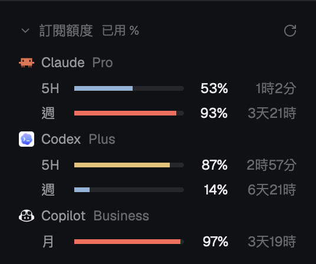

# Subscription quota

A foldable sidebar section lists how much of each coding-agent subscription you've used. It shows only subscriptions that are installed in Herdr and logged in, and only the time windows each service reports: Claude has a 5-hour and a weekly row (Ultra, formerly Max 20x, only the weekly one), Codex and Grok a weekly row, Copilot a monthly row for premium requests. It also lists what's left on the DeepSeek API account opencode uses.

## What you see

A block in the sidebar, above the footer, on `theme().chrome` with a 1px top border in `theme().border`. All text is 11.5px, in Traditional Chinese, or English with `props.lang: "en"`. Top to bottom:

1. **Header**, the same as the Agents section's: 41px tall with 14px top and 5px bottom padding, 16px side padding. On the left, in `theme().dim`: an 11px chevron (down when open, right when folded), `訂閱額度` (`Quota`) in medium weight, and 10.5px `已用 %` (`% used`) while open. On the right, while open: a 12px refresh icon.
2. **Per subscription, a 22px head row:** the 13px program icon, its name in medium weight `theme().muted`, and the plan in `theme().dim`. Without numbers (failed before any reply) it also says why, in `theme().dim`.
3. **Under it, one 20px row per window**, indented to start under the name, gap 6px:
   - 22px window label in `theme().muted` (42px when a pool name such as `Gemini` is listed): `5H`, `週` (week), `月` (month), `日` (day), or `<n>H`; in English `Wk`, `Mo`, `Day`.
   - A 4px bar with 2px corners filling the remaining width, on `theme().border`. The fill is `theme().accent`, `theme().working` from 70%, and `theme().blocked` from 90%.
   - 32px right-aligned percentage in `theme().foreground`.
   - 52px right-aligned time to reset in `theme().dim`: `12分`, `1時32分`, `5天22時` (`12m`, `1h32m`, `5d22h`).
   Rows sit in an 8px gutter with 6px corners and `theme().hover` behind them on hover, like the Agents list's rows.
   A balance row (DeepSeek), one per currency holding money, or the first currency at zero: `餘額` (`Bal`) as the label and the amount right-aligned (`¥10.68`, `$2.50`, `3.00 EUR`) in `theme().foreground`, or `theme().blocked` when the reply says `is_available: false`.
4. **With nothing listed:** `讀取中…` while loading, otherwise `沒有偵測到已登入的訂閱`.

On a sidebar narrower than 160px, the section is a centered chevron, then per subscription a 14px icon over the busiest window's percentage at 9.5px, or the balance without cents (`¥10`).

## How it behaves

- **Agent status** has no effect. Agents working, blocked, done or idle don't change this section.
- **Clicking the header** folds or opens the section. Folded, only the header shows and the block shrinks to fit. The state is kept in shared `quota.folded`.
- **Asking the services:** on load and every 5 minutes, except while folded or while the window is hidden (a poll missed while hidden is made up within a minute of showing again). Opening the section or clicking refresh asks again, at most once per 30 seconds. Every subscription is asked at once and shows as soon as its own answer comes, so a slow one (a helper can take 30 s) holds up only its own row. The icon spins while any is being asked.
- **A subscription that gives no answer at all** (its login couldn't be read, its CLI didn't start) keeps its last numbers, dimmed as `暫時查不到額度`, for up to 6 hours, then disappears as a signed-out one does.
- **Hovering a row** shows the plan, the percentage, the local reset time and why the data is old, if it is.
- **An expired login (401):** the numbers stay, with a dim bar and percentage, and the tooltip says to open the agent. With no earlier numbers, the row says `開啟 <agent> 後更新`. For DeepSeek, 401 means the key is wrong: `API 金鑰無效`.
- **Any other failure:** the same, with `暫時查不到額度`.
- **A window past its reset** shows `—` and `已重置` until the next reply.
- **The clock** redraws once a minute so the time to reset stays current.

## Built from

- **Layout:** `layouts/main-chat.json` ships with it: a block `{ "id": "quota", "type": "block", "size": { "px": 134 }, "content": { "mod": "quota", "props": { "fit_block": "quota" } } }` in `sidebar`, right before `sidebar-footer`.
- **Props:** `fit_block` names the block to resize to the content; `lang: "en"` switches the words to English (Traditional Chinese otherwise).
- **`mod.json`:** `{ "place": "none" }`.
- **Files:** `main.js` the view and requests, `model.js` pure parsing and formatting, `deepseek-balance.mjs` the DeepSeek helper, `refresh.svg`. DeepSeek's icon is Herdr's `icons/dsh-tui.svg`. It also uses Herdr's `mods/workspace-chrome/chevron-*.svg` and `icons/<agent>.svg`.
- **`herdr` functions:** `appHome`, `exec`, `home`, `knownAgents`, `layout`, `props`, `readTextFile`, `run`, `settings`, `setShared`, `shared`, `theme`, `window`. **Commands:** `layout.resize`. **Globals:** `fetch`, `localStorage`.
- **Sources,** one GET each, with the token as `Authorization: Bearer`:

| Agent | Login file | Counts as logged in when | Request | Windows |
|---|---|---|---|---|
| `claude` | `~/.claude/.credentials.json` | `claudeAiOauth.accessToken` and `subscriptionType` are set | `https://api.anthropic.com/api/oauth/usage`, header `anthropic-beta: oauth-2025-04-20` | `five_hour`, `seven_day`: `utilization`, `resets_at` |
| `codex` | `~/.codex/auth.json` | `auth_mode` is `chatgpt` and `tokens.access_token` is set | `https://chatgpt.com/backend-api/wham/usage`, header `ChatGPT-Account-Id` | `rate_limit.primary_window`, `secondary_window`: `used_percent`, `limit_window_seconds`, `reset_at` |
| `copilot` | none: `gh` keeps the login | `gh api /copilot_internal/user` exits 0. A program that can't start is tried again through `/bin/sh -lc` outside Windows, since a GUI app may lack the shell's PATH. `HTTP 401` or `gh auth login` on stderr counts as expired | run by `gh`, which asks `api.github.com` | `quota_snapshots.premium_interactions`: `100 - percent_remaining`, reset `quota_reset_date_utc`; `unlimited` isn't listed |
| `grok` | `~/.grok/auth.json` | an entry has `auth_mode: "oidc"` and `key` | `https://cli-chat-proxy.grok.com/v1/billing?format=credits`, header `x-userid` | `config.creditUsagePercent`, `config.currentPeriod` |
| `deepseek` (shown when `opencode` is installed) | `DEEPSEEK_API_KEY`, else `credential` row `integration_id = 'deepseek'` in `~/.local/share/opencode/opencode.db` (`value.key`), else `deepseek.key` in opencode's `auth.json` | a key is found | `https://api.deepseek.com/user/balance`, run by `node deepseek-balance.mjs`, which prints `{ status, body }`, or `{ login: false }` | `balance_infos[]`: `currency`, `total_balance`; `is_available` |

## Watch out

- **macOS can hold several `Claude Code-credentials` Keychain items,** one under the account `unknown` from an older Claude Code with no login in it. Ask for the one under the user's account (`-a`) first, then any.
- **Never refresh a token.** A refresh could sign the agent out. The agents renew their own tokens when they run, and the section recovers on its next request.
- **A mod can't read SQLite,** and opencode 1.x keeps its keys in `opencode.db`. The helper reads it with `node:sqlite` (Node.js 22.5+), so the key stays out of the mod. Without `node`, the DeepSeek row just isn't listed.
- **Never store or log a token.** `localStorage` holds only plans, percentages, times and icon paths, and each token goes only to the service that issued it.
- **These endpoints aren't public APIs** and can change without notice. `model.js` is the only place that knows their shapes.
- **Some services send more than 3 fractional digits.** Trim them before `Date.parse`.
- **A copy doesn't start until its block first shows,** so fold inside the mod. Hiding the block with `layout.hide` would stop it from ever coming back after a restart.
- **Layout `size.height` is scaled by `settings().zoom`:** divide before calling `layout.resize`.
- **Limits:** the words are Traditional Chinese or English. Claude, Codex, Grok, Copilot, DeepSeek and Antigravity (its desktop app's local language server, a Gemini row and a shared Claude + GPT row) are the only sources; add others to `PROVIDERS` in `model.js`. Tested on Windows 11 with Herdr 0.1.12, and on macOS with Herdr 0.9.5.

## Done when

- `herdr-app check` passes on the mod folder, `status` shows `errors: []`, and `node --test "test/*.test.mjs"` passes.
- A logged-in subscription shows the windows its service reports, with percentages and times that match the agent's own usage screen.
- An agent that isn't installed or logged in, or an account with no quota, isn't listed.
- Clicking the header folds and opens the section, the block resizes each way, and the state survives a restart.
- No requests are made while folded.
- With opencode's DeepSeek key, the balance matches DeepSeek's own platform page.
- With an invalid token the row keeps its last numbers, dimmed, and the tooltip says to open the agent.
- The narrow sidebar shows the icons and numbers.
- No token appears in the Herdr home after a refresh.
