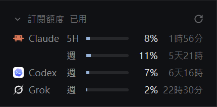

# Subscription quota

A foldable sidebar section lists how much of each coding-agent subscription you've used. It shows only subscriptions that are installed in Herdr and logged in, and only the time windows each service reports: Claude has a 5-hour and a weekly row, Codex and Grok a weekly row.

## What you see

A block in the sidebar, above the footer, on `theme().chrome` with a 1px top border in `theme().border`. All text is 11.5px and in Traditional Chinese. Top to bottom:

1. **Header**, 36px tall with 10px top padding and 16px side padding. On the left, in `theme().dim`: an 11px chevron (down when open, right when folded), `訂閱額度` in medium weight, and 10.5px `已用` ("used") while open. On the right, while open: a 12px refresh icon.
2. **One 21px row per window**, 16px side padding, gap 6px:
   - 60px name cell, on a subscription's first row only: the 13px program icon and its name in `theme().muted`.
   - 18px window label in `theme().muted`: `5H`, `週` (week), `月` (month), `日` (day), or `<n>H`.
   - A 4px bar with 2px corners filling the remaining width, on `theme().border`. The fill is `theme().accent`, `theme().working` from 70%, and `theme().blocked` from 90%.
   - 30px right-aligned percentage in `theme().foreground`.
   - 50px right-aligned time to reset in `theme().dim`: `12分`, `1時32分`, `5天22時`.
3. **With nothing listed:** `讀取中…` while loading, otherwise `沒有偵測到已登入的訂閱`.

On a sidebar narrower than 160px, the section is a centered chevron, then per subscription a 14px icon over the busiest window's percentage at 9.5px.

## How it behaves

- **Agent status** has no effect. Agents working, blocked, done or idle don't change this section.
- **Clicking the header** folds or opens the section. Folded, only the header shows and the block shrinks to fit. The state is kept in shared `quota.folded`.
- **Asking the services:** on load and every 5 minutes, except while folded. Opening the section or clicking refresh asks again, at most once per 30 seconds. The icon spins while asking.
- **Hovering a row** shows the plan, the percentage, the local reset time and why the data is old, if it is.
- **An expired login (401):** the numbers stay, with a dim bar and percentage, and the tooltip says to open the agent. With no earlier numbers, the row says `開啟 <agent> 後更新`.
- **Any other failure:** the same, with `暫時查不到額度`.
- **A window past its reset** shows `—` and `已重置` until the next reply.
- **The clock** redraws once a minute so the time to reset stays current.

## Built from

- **Layout:** a block `{ "id": "quota", "type": "block", "size": { "px": 134 }, "content": { "mod": "quota", "props": { "fit_block": "quota" } } }` in `sidebar`, right before `sidebar-footer`.
- **Props:** `fit_block` names the block to resize to the content.
- **`mod.json`:** `{ "place": "none" }`.
- **Files:** `main.js` the view and requests, `model.js` pure parsing and formatting, `refresh.svg`. It also uses Herdr's `mods/workspace-chrome/chevron-*.svg` and `icons/<agent>.svg`.
- **`herdr` functions:** `home`, `knownAgents`, `layout`, `props`, `readTextFile`, `run`, `settings`, `setShared`, `shared`, `theme`. **Commands:** `layout.resize`. **Globals:** `fetch`, `localStorage`.
- **Sources,** one GET each, with the token as `Authorization: Bearer`:

| Agent | Login file | Counts as logged in when | Request | Windows |
|---|---|---|---|---|
| `claude` | `~/.claude/.credentials.json` | `claudeAiOauth.accessToken` and `subscriptionType` are set | `https://api.anthropic.com/api/oauth/usage`, header `anthropic-beta: oauth-2025-04-20` | `five_hour`, `seven_day`: `utilization`, `resets_at` |
| `codex` | `~/.codex/auth.json` | `auth_mode` is `chatgpt` and `tokens.access_token` is set | `https://chatgpt.com/backend-api/wham/usage`, header `ChatGPT-Account-Id` | `rate_limit.primary_window`, `secondary_window`: `used_percent`, `limit_window_seconds`, `reset_at` |
| `grok` | `~/.grok/auth.json` | an entry has `auth_mode: "oidc"` and `key` | `https://cli-chat-proxy.grok.com/v1/billing?format=credits`, header `x-userid` | `config.creditUsagePercent`, `config.currentPeriod` |

## Watch out

- **Never refresh a token.** A refresh could sign the agent out. The agents renew their own tokens when they run, and the section recovers on its next request.
- **Never store or log a token.** `localStorage` holds only plans, percentages, times and icon paths, and each token goes only to the service that issued it.
- **These endpoints aren't public APIs** and can change without notice. `model.js` is the only place that knows their shapes.
- **Some services send more than 3 fractional digits.** Trim them before `Date.parse`.
- **A copy doesn't start until its block first shows,** so fold inside the mod. Hiding the block with `layout.hide` would stop it from ever coming back after a restart.
- **Layout `size.height` is scaled by `settings().zoom`:** divide before calling `layout.resize`.
- **Limits:** the words are Traditional Chinese only. Claude, Codex and Grok are the only sources; add others to `PROVIDERS` in `model.js`. Tested on Windows 11 with Herdr 0.1.12.

## Done when

- `herdr-app check` passes on the mod folder, `status` shows `errors: []`, and `node --test "test/*.test.mjs"` passes.
- A logged-in subscription shows the windows its service reports, with percentages and times that match the agent's own usage screen.
- An agent that isn't installed or logged in, or an account with no quota, isn't listed.
- Clicking the header folds and opens the section, the block resizes each way, and the state survives a restart.
- No requests are made while folded.
- With an invalid token the row keeps its last numbers, dimmed, and the tooltip says to open the agent.
- The narrow sidebar shows the icons and numbers.
- No token appears in the Herdr home after a refresh.
