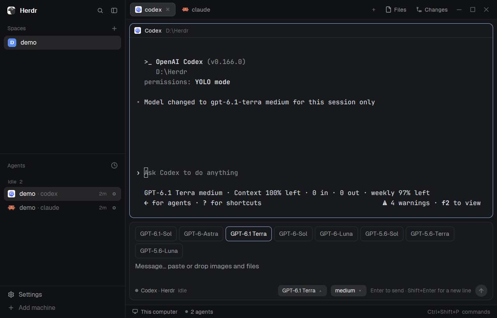

# Chat box

A rounded message box sits under the terminals, in the same column, and grows with what you type. You write in it like a desktop chat app: Enter sends to the focused terminal, images and files can be pasted or dropped in, and two pills in its corner show and switch the agent's model and reasoning effort.

## What you see

Everything is inside a card that fills the block's width: 10px corners, 1px border (`theme().border`, `theme().accent` while the box has the keyboard), `theme().background`, padding 9px top, 12px sides, 7px bottom, 6px between rows. Top to bottom:

1. **Attachments**, only when there are some. A wrapping row of 64px-tall thumbnails with 8px corners, gap 6px. An image shows itself. Another file shows a file icon and its name, up to 220px wide. Each has an 18px round × in its top right corner. While the clipboard is being read, a "Reading clipboard…" tile sits at the end of the row.
2. **Choices**, only while a pill is open. A wrapping row of bordered 12.5px options, 7px corners, gap 5px. The current one has an accent border and foreground text; the rest are muted, with a hover background.
3. **Text area.** 14px, auto-growing from 2 to 12 rows, placeholder "Message… paste or drop images and files".
4. **Bottom line**, 11.5px, gap 8px:
   - Left, filling the space: a 7px dot in the status color, the program's name, ` · ` and the pane title when they differ, and a dim status word (working, needs you, done, idle). An error replaces all this in `theme().blocked`; a notice such as "Switched to medium (this session only)" replaces it in muted text.
   - Two pills for a known agent: 24px tall, 7px corners, `theme().raised` (`theme().selected` when open), the value and a ▾ or ▴. With no value yet they read "Model" and "Effort"; while switching, the first reads "Switching…".
   - A dim hint "Enter to send · Shift+Enter for a new line", only when the box is wider than 760px or a message is sending ("Sending…").
   - A 26px round send button with an arrow icon: `theme().solid` when there's something to send, `theme().raised` otherwise.

## How it behaves

- **Agent status** only changes the bottom line: the dot takes `theme()[status]`, and the word follows. A switch is refused with an explanation while the agent is `working` or `blocked`.
- **Enter** sends; **Shift+Enter** makes a new line. **Esc** gives the keyboard back to the terminal. **Ctrl+Shift+J** (`chat-box.focus`) focuses the box. Commands `send` and `paste` do what they say.
- **Sending** clears the box at once. A failed send puts the text and files back ahead of anything typed since, and says what happened. A blocked agent gets its own message; other failures warn that the message may have arrived.
- **Target:** the focused terminal. With a mod pane focused, the last terminal of the shown tab. Each terminal keeps its own draft and attachments, and switching closes any open menu.
- **Paste with no text** reads the clipboard's image or files. **Dropped** files attach. An image gets a preview; a file that can't be previewed still sends. Duplicates are ignored.
- **Message format:** the words, a blank line, then the paths on one line, quoted the way Herdr's own terminal drop quotes them. Claude Code turns those into `[Image #1]` attachments.
- **Over 30,000 characters,** the text goes in a file and the message asks the agent to read it. A remote terminal gets its files through `hc put`.
- **Pills:** clicking opens the choices, rereads the agent's screen, and keeps the keyboard in the box so Enter still sends. Picking a choice switches, then shows the result as a notice or error.
- **The block's height** follows the card through `layout.resize`, so the terminal gives up exactly the space used.

## Built from

- **Layout:** a clone of `main` where `work-body > main` is wrapped in a column `main-column` (gap 8, not resizable). It holds the original `main` and a block `chat`, `{ "px": 96 }`, with `{ "mod": "chat-box", "props": { "fit_block": "chat" } }`. The root has `"message_box": "chat-box"`, which official builds ignore.
- **Props:** `fit_block` names the block to resize. `lang` is optional, `"zh-TW"` or English by default.
- **`mod.json`:** `{ "place": "none", "focusable": true }`.
- **Files:** `main.js` the view, `agents.js` each agent's reading and switching, `logic.js` pure helpers, `i18n.js` the words, `clipboard.js` with `clipboard.ps1` and `copy.ps1`, `send.svg`, `file.svg`.
- **`herdr` functions:** `appHome`, `exec`, `focused`, `hc`, `home`, `nextCommand`, `panes`, `props`, `readTextFile`, `run`, `settings`, `theme`. **Commands:** `pane.focus`, `layout.resize`. **`fs/promises`** for `data/chat-box/`.
- **`hc` calls:** `send --json <t> -- <text>`, `keys --json <t> <key>`, `read <t>`, `put --json <t> <file>`.
- **Programs:** `powershell.exe -NoProfile -NonInteractive -STA -ExecutionPolicy Bypass -File`.
- **Agents,** by `pane.program.key`:
  - `claude`: reads `Haiku 5.5 with low effort · `, `Set model to X`, `Set effort level to X` and `◐ medium · /effort`. Sends `/model` or `/effort`, moves with the arrow keys, checks the screen, then presses `s`.
  - `codex`: reads `GPT-6.1 Terra high · Context`. Sends `/model <slug> --reasoning=<level>` and waits for `Model changed to <slug> <level>`. Its list comes from `~/.codex/models_cache.json`, `.models[]` with `visibility: "list"`.
  - `grok`: reads `Grok 4.6 (high)` on the box's border. Sends `/model <id>` or `/effort <level>`.

## Watch out

- **Never press Enter in Claude Code's pickers, and never send `/model X` or `/effort X` with an argument.** Both save a new default in `~/.claude/settings.json`. `s` is what keeps it to the session.
- **Codex's `/model` without a level resets the effort,** so always send one. It has no `/effort`.
- **Grok always writes `~/.grok/config.toml`.** Say so in the notice. When testing, back the file up and restore it.
- **Claude Code's picker shows as few as two rows in a short pane** and scrolls with the cursor. Walk one row at a time and read the cursor each step. Its first row can't always be reached, and a key pressed right after it opens can get lost: wait 400ms, and take two failed moves to mean an end of the list. On any failure, press Esc.
- **Read with plain `hc read <t>`.** `--lines N` asks for history as well and can take about 2.5 seconds.
- **A Textarea inserts its newline before it reports Enter.** Take the value from before the key, and don't set text state while rendering; defer it with a timer.
- **The theme is often in a variable called `t`,** so don't name the translation function that in `main.js`.
- **`image()` only loads paths inside the app home,** so previews are copies in `data/chat-box/`, pruned after 7 days.
- **Pass paths to PowerShell through `-File` arguments.** `cmd /c` breaks on `&` in file names.
- **Layout `size.height` is scaled by `settings().zoom`:** divide before calling `layout.resize`.
- **Assumes** Windows, `powershell.exe`, and the agents' current screens. Claude Code's and Grok's model lists are hardcoded.
- **The agents' own input boxes stay visible on official Herdr.** Hiding them needs `patches/hide-agent-input.patch` and a custom build. It adds the `message_box` layout field and delivers typing in a hidden box to the mod's `nextCommand()` as `type:<text>`, which this mod already handles.

## Done when

- `herdr-app check` passes on the mod folder, `status` shows `errors: []`, and `node --test "test/*.test.mjs"` passes.
- The box sits under the terminals and grows as lines are added. The terminal shrinks to match.
- A message sent with Enter arrives in the focused terminal, Shift+Enter makes a new line, and an empty Enter sends nothing.
- A pasted image and a dropped file show as thumbnails, and Claude Code receives both.
- Each tab keeps its own draft.
- The pills show the real model and effort for Claude Code, Codex and Grok.
- Switching Claude Code and Codex says "this session only" and leaves `~/.claude/settings.json` and `~/.codex/config.toml` byte for byte the same.
- Switching Grok updates its box and says its default changed.
- Switching is refused while the agent is working or blocked.
